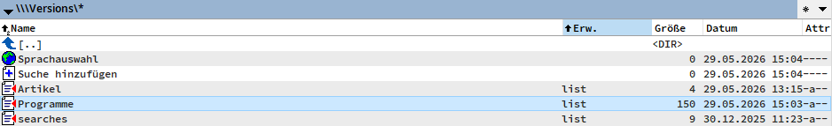
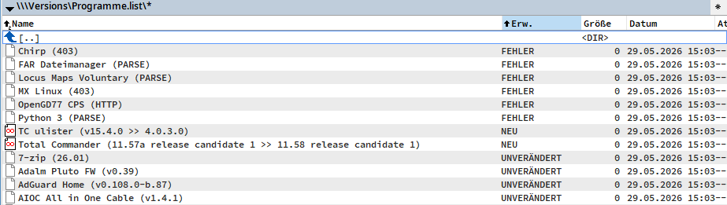

# Versions WFX Plugin (Total Commander)

`Versions` is a Total Commander file system plugin that checks program/version strings on web pages and shows the current status directly in TC.

This repository contains an updated FPC/Lazarus-compatible codebase with reliability, parsing, and UX improvements.




## Key Features

- Checks version entries from `.list` files.
- Checks downloadable files through `Last-Modified` without downloading their
  body, with a streaming SHA-256 fallback when no usable server timestamp exists.
- Exposes numeric WFX custom columns for the visible list position and physical
  source line.
- Shows `#`, `##`, and `###` list comments as non-executable virtual rows with
  a comment icon and three visual indentation levels.
- Supports HTTPS and modern HTTP behavior.
- Keeps list entry order in output.
- Shows localized status labels (`NEW`, `UNCHANGED`, `ERROR`, etc.) based on selected language file.
- Works with Unicode and 64-bit builds.

## Recently Added / Improved

- Parallel page fetching with configurable worker count.
  - New INI key: `MaxParallelRequests` (default `8`).
  - Results are processed and shown after all list entries are finished.
  - Return values are evaluated per entry.
- Configurable connection timeout.
  - New INI key: `ConnectTimeout` in milliseconds (default `5000`).
- Windows-native HTTPS stack.
  - HTTP transport now uses WinHTTP instead of OpenSSL sockets.
  - Removes OpenSSL runtime DLL dependency for HTTPS in this plugin.
- Optional request logging.
  - New INI keys: `RequestLog` and `RequestLogFile`.
  - Thread-safe logging with timestamp, URL, status, and error code.
- Better handling of `.list` files.
  - Empty lines are ignored.
  - Lines starting with `;` are treated as comments and ignored.
  - `.list` files may be organized in arbitrary nested subfolders below the plugin's `Lists` directory; that hierarchy is reflected in `Network Neighborhood > Versions`.
  - `.list` files beside the plugin DLL remain visible and behave exactly as before.
  - Outside the `Lists` tree, other plugin subfolders are ignored. Within `Lists`, only folders containing at least one `.list` file directly or recursively are displayed.
  - The displayed `.list` file size shows the number of valid entries (non-empty, non-comment), including lists in subfolders.
- Parser improvements for markers.
  - Marker matching works across line breaks.
  - Version text is extracted with original casing preserved.
  - Found version text is limited to `64` UTF-8 bytes.
- Progress display improvements.
  - Total Commander progress now includes current count and the entry name (first field in `.list`).
- Improved request robustness.
  - Firefox-like User-Agent and browser-like headers.
  - Retry handling for transient HTTP/IO errors.
- Automatic protection-page handling.
  - Detects Cloudflare challenge/block pages, Anubis challenges, and simple JavaScript-cookie challenges from HTTP headers and HTML signatures.
  - Transparently decompresses gzip/deflate HTTP responses before protection detection and marker parsing.
  - Does not mistake Cloudflare's JavaScript detector embedded in an otherwise complete page for an active challenge.
  - Keeps WinHTTP as the normal transport and starts Chrome only for a detected protection page.
  - Uses a Chrome-version-matched normal browser User-Agent instead of the detectable HeadlessChrome identifier.
  - If an interactive Cloudflare or Anubis challenge remains, temporarily starts a normal Chrome window off-screen and reads its final DOM through a localhost DevTools connection.
  - Closes that Chrome instance via DevTools after success, timeout, or cancellation; a dedicated Windows job object removes remaining child processes as a fallback.
  - Bounds each synchronous DevTools WebSocket read to five seconds, so a stalled DOM response cannot bypass the configured Chrome timeout.
  - Uses a separate persistent Chrome profile so challenge cookies can be reused.
  - Serializes Chrome calls while regular WinHTTP requests remain parallel.
- Localized error output.
  - Errors are shown with localized error extension (language-dependent), while keeping technical details in logs.

## `.list` Format

A standard entry uses six fields:

`Name|URL|StartMarker|LeftMarker|RightMarker|CurrentVersion`

A search-only entry uses three fields:

`Name|URL|Parameters`

A downloadable-file entry also uses six fields, but leaves the first two
search markers empty:

`Name|URL|||ComparisonValue|DisplayDate`

Example before the first check:

`AFU Rufzeichenliste|https://example.invalid/file-page.html|||checksumme|01.01.2024`

The plugin recognizes this as file mode because `StartMarker` and `LeftMarker`
are empty. `ComparisonValue` is maintained automatically:

- `last-modified:2026-10-23T06:44:00Z` means the final server response supplied
  a valid `Last-Modified` header. The full UTC timestamp is compared, while
  `DisplayDate` contains the readable local list value such as `23.10.2026`.
- `sha256:<64 hexadecimal characters>` means no usable `Last-Modified` was
  available. The file is streamed through SHA-256 without keeping the complete
  file in memory. `DisplayDate` is the date on which that exact checksum was
  first observed.

File-check sequence:

1. Existing redirects are followed automatically.
2. Unless the entry is already in SHA-256 mode, the plugin first sends `HEAD`.
3. If necessary, it retries the header probe with `GET` and
   `Range: bytes=0-0`; the response body is not downloaded.
4. A valid `Last-Modified` is stored and compared without downloading the file.
5. Without `Last-Modified`, the complete file is downloaded once and hashed.
6. A stored `sha256:` value keeps the entry in SHA-256 mode. To retry
   `Last-Modified`, clear only `ComparisonValue` while retaining all pipe
   separators, for example `Name|URL||||23.10.2026`.

The checksum/timestamp and display date are changed only after a successful,
complete check. Cancellation, timeout, HTTP errors, or an HTML response where a
file was expected leave the list entry unchanged. When switching comparison
methods without a comparable previous value, the new value becomes a baseline
and is shown as unchanged. An existing date can be used for a one-time
date-only comparison when initializing or returning to `Last-Modified` mode.

Notes:

- Empty lines are ignored.
- Lines whose first non-space character is `;` are internal comments and remain
  hidden.
- Lines whose first non-space characters are `#`, `##`, or `###` are visible
  comments. The marker and whitespace immediately following it are omitted in
  the virtual name: `# Text` is shown as `Text`, `## Text` as `    Text`, and
  `### Text` as `        Text`. A marker without text is shown as `(comment)`.
  They never trigger a request, URL, editor, download, or other execution.
- Characters that are invalid in virtual Windows filenames are replaced only in
  the displayed comment name. The original `.list` line is saved unchanged.
- If two visible rows would have the same name, a visible comment receives a
  source-line suffix such as `[line 12]` to keep its virtual path unique.
- Marker text can span multiple lines in downloaded HTML source.
- 3-field entries are shown as `.SEARCH` (localized) and are not fetched for version parsing.
- Lists can be placed beside the plugin DLL or recursively below `Lists`, for example `Lists\Utilities\NirSoft.list`. The same folders appear below `Network Neighborhood > Versions`; other plugin subfolders are not scanned.

## Custom Columns And Original Order

The WFX plugin exports three content fields:

- `List position` is the consecutive visible position (`1, 2, 3, ...`). Hidden
  empty lines and `;` comments do not consume a position. Sorting ascending by
  this field restores the visible order of the `.list`, including all three
  comment levels.
- `Source line` is the physical one-based line number in the `.list`. It can
  contain gaps because empty lines and `;` comments remain hidden.
- `Name` is the final component of the virtual path passed by Total Commander,
  including an existing extension. It is available for files and folders and
  can be added to any custom-column view.

In a Total Commander custom-column view, the fields are available as:

- `[=<fs>.List position]`
- `[=<fs>.Source line]`
- `[=<fs>.Name]`

`List position` and `Source line` are empty for the plugin root, folders,
language entries, and list files themselves. Their values are cached by full
virtual path, so Total Commander may request them later or in a different order
without changing the reported position. `Name` is available for every non-root
virtual item.

The plugin also supplies a default WFX column view. Total Commander contributes
its fixed name and extension columns; the plugin view adds `List position` and
`Source line`. The separate plugin field `Name` is not added there to avoid a
duplicate name column. When entering the plugin, Total Commander switches to
the view automatically if **Use plugin columns** is enabled in Total
Commander's custom-column settings. The plugin does not modify `wincmd.ini`;
disabling that Total Commander option keeps the user's selected standard or
custom view.
Both ANSI and Unicode default-view callbacks are exported; current Windows
versions of Total Commander use the Unicode callback.

## Status And Error Codes

Result lines are shown like:

- `ProductName (value).NEW`
- `ProductName (value).UNCHANGED`
- `ProductName (CODE).ERROR` (localized extension text)

Meaning of common codes inside `(...)`:

- `403 - Forbidden`, `404 - Not Found`, `503 - Service Unavailable`, ...  
  HTTP status code returned by the server, followed by its standard reason phrase when known.
- `PARSE`  
  The configured markers could not be found/matched in the fetched page.
- `FILE - HTML response`  
  A file-check entry returned an HTML page instead of a downloadable file. The
  stored comparison value is not changed.
- `EMPTY`  
  Request finished, but no response body was returned.
- `ABORT`  
  User canceled while progress dialog was active.
- `WIN12002`  
  WinHTTP timeout (`ERROR_WINHTTP_TIMEOUT`).
- `WIN12007`  
  Name resolution failed (`ERROR_WINHTTP_NAME_NOT_RESOLVED`).
- `WIN12029`  
  Cannot connect (`ERROR_WINHTTP_CANNOT_CONNECT`).
- `WIN12030`  
  Connection error (`ERROR_WINHTTP_CONNECTION_ERROR`).
- `WIN12032`  
  Request retry required by WinHTTP (`ERROR_WINHTTP_RESEND_REQUEST`).
- `WIN12005`  
  Invalid URL (`ERROR_WINHTTP_INVALID_URL`).
- `ERROR`  
  Generic fallback when no more specific code is available.
- `403 - Forbidden - Cloudflare Protection - Chrome not found`  
  A Cloudflare protection page was detected, but Chrome is not installed or could not be located.
- `403 - Forbidden - Cloudflare Protection - Chrome still Cloudflare Protection`  
  Chrome loaded the page, but Cloudflare still returned a challenge or block page.
- `200 - OK - Anubis Challenge - Chrome background timeout`  
  Anubis was detected and the normal, off-screen Chrome fallback did not finish within the configured time.

Notes:

- `HTTP`/`EHTTPClient` style errors are from older implementations; current builds use WinHTTP and show HTTP status codes or `WINxxxxx`.
- The extension after the code is localized (for example `.ERROR` in English, translated labels in other language files).
- If `RequestLog=1`, technical details are written to `RequestLogFile` with timestamp, URL, status, and error code.

## Configuration (`versions.ini`)

The plugin reads configuration from `versions.ini` in the plugin directory.

Supported keys:

- `Language`  
  Language file without extension, e.g. `ver_English`.
- `UseLowerCase`  
  `1`/`0`, default `1`. Controls case-insensitive marker search behavior.
- `DontValidateCertificate`  
  `1`/`0`, default `0`. Disables SSL certificate validation when enabled.
- `MaxParallelRequests`  
  Integer, default `8`. Number of parallel fetch workers.
- `ConnectTimeout`  
  Integer milliseconds, default `5000`. Connection timeout per request.
- `RequestLog`  
  `1`/`0`, default `0`. Enables request logging.
- `RequestLogFile`  
  Log filename/path, default `versions_http.log`.  
  Relative paths are resolved against plugin directory.
- `ChromeFallback`  
  `1`/`0`, default `1`. Enables the automatic Chrome fallback for detected Cloudflare/Anubis pages.
- `UseChromeHeadless`  
  `1`/`0`, default `1`. Enables the first Chrome attempt with `--headless=new` and DOM output.
- `UseChromeHidden`  
  `1`/`0`, default `1`. Enables the fallback normal Chrome window, positioned off-screen, for challenges that need a full browser. Set this to `0` to prevent such a Chrome window from being started.
- `ChromePath`  
  Optional full path to `chrome.exe`. If empty, the plugin checks the Windows App Paths registry and the standard per-machine/per-user Chrome locations.
- `ChromeProfileDir`  
  Optional profile directory used only by the Chrome fallbacks. Default: `%LOCALAPPDATA%\VersionsWFX\ChromeProfile`.
- `ChromeTimeout`  
  Integer milliseconds, default `10000`, minimum `5000`. Timeout for each Chrome fallback; the headless attempt uses it additionally as JavaScript virtual-time budget.

The Chrome fallback is intentionally limited to detected protection pages. A regular HTTP error, a normal JavaScript page, or a page merely hosted behind Cloudflare continues to use WinHTTP only. `UseChromeHeadless` and `UseChromeHidden` can be set independently; with both set to `0`, detected protection pages remain WinHTTP errors with the detected protection noted.

## Build

This project is configured for Free Pascal / Lazarus (`{$mode objfpc}`).

Example build command:

```powershell
lazbuild versions.lpi
```

Typical output binary:

- `Versions.wfx64`

## Original Credits

- Original plugin author: Fabio Chelly
- Later maintenance: ProgMan13

See `readme.txt` for original historical notes and legacy changelog.
nly
